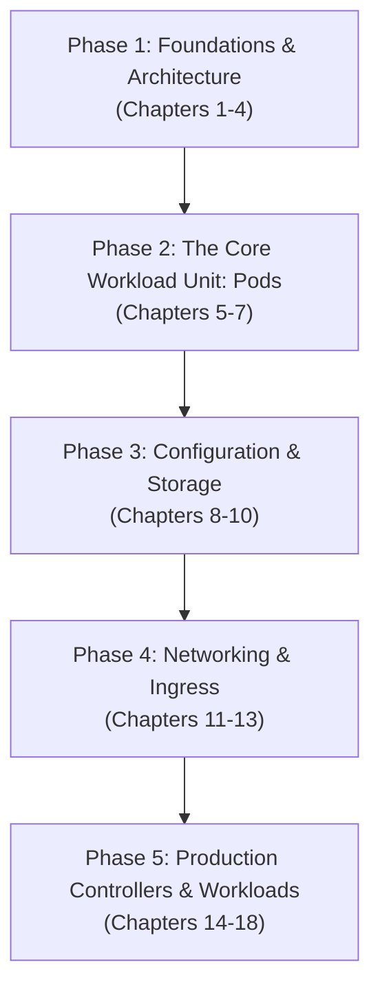

# Book Map: Kubernetes in Action (2nd Edition)

This document maps the architecture, progression, and note-taking strategy for *Kubernetes in Action (2nd Edition)* by Marko Luksa and Kevin Conner (Manning Early Access Program, 18 chapters, 928 pages). It serves as the persistent context for study sessions, preventing redundant re-reads of the PDF.

---

## 🧭 Pedagogical Structure of the Book

The book uses a single progressive sample application called **Kiada** (a multi-tier quiz service starting with Node.js, growing to include an Envoy TLS sidecar, quote backend, and Redis datastore).

The material progresses in five distinct phases:

### Phase 1: Foundations & The API Contract (Chapters 1 to 4)
* **Chapter 1: Introducing Kubernetes:** High-level origins, container orchestration benefits, and control plane vs worker node split.
* **Chapter 2: Understanding Containers and Containerized Applications:** Linux namespaces, cgroups, container runtimes, image layering, and building images.
* **Chapter 3: Deploying Your First Application on Kubernetes:** Setting up local clusters (Kind, Minikube, GKE, EKS) and running an ad-hoc workload with `kubectl`.
* **Chapter 4: Navigating the Kubernetes API and Object Model:** The REST API foundation, manifest anatomy (`apiVersion`, `kind`, `metadata`, `spec`, `status`), controller reconciliation loops, `kubectl explain` discovery, Node status conditions, and cluster Event streams.

### Phase 2: The Core Workload Unit: Pods (Chapters 5 to 7)
* **Chapter 5: Running Applications with Pods:** Grouping containers, shared network and IPC namespaces, sidecar pattern (Envoy reverse proxy), init containers, native sidecars, and debugging via `kubectl exec`, `logs`, and ephemeral containers.
* **Chapter 6: Managing the Pod Lifecycle and Container Health:** Pod phases and conditions, container restart policies, liveness and startup probes, and preStop hooks for graceful shutdown.
* **Chapter 7: Organizing Pods and Other Resources using Namespaces and Labels:** Virtual cluster isolation (Namespaces), metadata tagging (Labels and Annotations), target filtering (Label Selectors and Field Selectors), and node scheduling constraints.

### Phase 3: Configuration & Storage (Chapters 8 to 10)
* **Chapter 8: Configuring Applications with ConfigMaps and Secrets:** Decoupling application configuration from container images, passing environment variables and arguments, mounting configuration volumes, Secrets encryption and access, and Downward API metadata injection.
* **Chapter 9: Adding Volumes for Storage, Configuration, and Metadata:** Ephemeral storage with `emptyDir`, host filesystem access with `hostPath`, projected volumes, and sharing volumes across containers in a pod.
* **Chapter 10: Persisting Data with PersistentVolumes:** Decoupled storage lifecycle, PersistentVolumes (PVs), PersistentVolumeClaims (PVCs), StorageClasses with dynamic provisioning, volume snapshots, and state retention policies.

### Phase 4: Networking & Ingress (Chapters 11 to 13)
* **Chapter 11: Exposing Pods with Services:** East-West traffic, stable virtual IPs (ClusterIP), `kube-proxy` packet translation (iptables and IPVS), `Endpoints` and `EndpointSlice` discovery, internal CoreDNS resolution, readiness probes for traffic gating, and external exposure (NodePort, LoadBalancer).
* **Chapter 12: Using Ingress to Route Traffic to Services:** Layer 7 HTTP/HTTPS reverse proxy routing, Ingress controllers, TLS termination, virtual hosting, path-based routing, and `IngressClass` routing.
* **Chapter 13: Routing Traffic using the Gateway API:** The modern successor to Ingress. Role-oriented networking architecture, `GatewayClass`, `Gateway`, `HTTPRoute`, `TLSRoute`, traffic splitting, canary releases, and service mesh integration (Istio).

### Phase 5: Production Controllers & Workloads (Chapters 14 to 18)
* **Chapter 14: Scaling and Maintaining Pods with ReplicaSets:** Automated pod replication, self-healing against node crashes, the reconciliation loop under the hood, and owner references with garbage collection.
* **Chapter 15: Automating Application Updates with Deployments:** Declarative rollout strategies (RollingUpdate vs Recreate), surge and unavailable thresholds, rollout monitoring, pauses, and rollbacks via Revision history.
* **Chapter 16: Handling Stateful Applications with StatefulSets:** Stateful workload challenges, sticky network identity, ordered ordinal scaling and termination, headless Services, and per-replica dedicated persistent volume claim templates.
* **Chapter 17: Deploying Per-Node Workloads with DaemonSets:** Running system agents (log collectors, monitoring daemons, CNI network plugins) exactly once per node, node selector scheduling, tolerations, and host namespace privileges.
* **Chapter 18: Batch Processing with Jobs and CronJobs:** Run-to-completion finite workloads, parallelism, indexed jobs, backoff failure retries, and scheduled execution via CronJobs.

---

## 🔗 How Chapter 4 Anchors the Entire Book

Chapter 4 is the **grammatical foundation** of Kubernetes. Without it, the rest of the book is incomprehensible:

1. **The Universal Manifest Contract:**
   Every single Kubernetes object introduced in chapters 5 through 18 follows the four-section schema introduced in chapter 4:
   - `apiVersion` (API group and version)
   - `kind` (the REST resource type)
   - `metadata` (identity, namespace, labels, annotations)
   - `spec` (the desired state, written by the human or client)
   - `status` (the actual observed state, written by the controller)

2. **The Universal Reconciliation Loop:**
   Chapter 4 explains the separation between user intent (`spec`) and system reality (`status`). Every controller discussed later (ReplicaSet, Deployment, StatefulSet, DaemonSet, Job) is merely a specialized implementation of this exact loop.

3. **Autonomous CLI Discovery (`kubectl explain`):**
   Instead of memorizing thousands of YAML fields, chapter 4 teaches how to interrogate the API server directly using `kubectl explain <resource>.<field>`. This skill is required for every manifest written in chapters 5 through 18.

4. **Cluster Health & Triage Primitives:**
   Chapter 4 introduces node status conditions (`Ready`, `MemoryPressure`, `DiskPressure`, `PIDPressure`) and the cluster event stream (`kubectl get ev`). These are the primary tools used to debug failed rollouts, scheduling bottlenecks, and container crashes in later chapters.

---

## 🗂️ Target Vault Note Architecture for Kubernetes

To keep notes concise, atomic, and free of book bloat, map the 18 chapters into permanent atomic notes in `6 - Main notes/07 - Kubernetes & Cloud/`:

| Note Title | Book Source | Core SRE Focus | Status |
| :--- | :--- | :--- | :--- |
| `Kubernetes Architecture and Control Plane.md` | Chapters 1 & 3 | Master components, etcd, kubelet, node agents | Done |
| `Kubernetes API and Object Model.md` | Chapter 4 | REST API, Spec vs Status, manifest anatomy, `kubectl explain`, Node conditions, Event triage | Done |
| `Kubernetes Pods - Anatomy and Lifecycle.md` | Chapters 5 & 6 | Namespaces, sidecars, init containers, probes, preStop hooks, triage commands | Next |
| `Kubernetes Organization - Namespaces and Labels.md` | Chapter 7 | Metadata, label selectors, field selectors, affinity | Backlog |
| `Kubernetes Configuration - ConfigMaps and Secrets.md` | Chapter 8 | Decoupling config, secrets management, Downward API | Backlog |
| `Kubernetes Storage - Volumes and PersistentVolumes.md` | Chapters 9 & 10 | `emptyDir`, `hostPath`, PVs, PVCs, StorageClasses | Backlog |
| `Kubernetes Services and Traffic Routing.md` | Chapter 11 | ClusterIP, NodePort, kube-proxy, iptables/IPVS, Endpoints | Done |
| `Kubernetes Ingress and Gateway API.md` | Chapters 12 & 13 | Layer 7 routing, Ingress controllers, Gateway API, traffic splitting | Backlog |
| `Kubernetes Workloads - Deployments and ReplicaSets.md` | Chapters 14 & 15 | Declarative rollouts, RollingUpdate, self-healing, rollbacks | Review/Update |
| `Kubernetes StatefulSets and Storage Identity.md` | Chapter 16 | Ordinal identity, headless services, volume claim templates | Backlog |
| `Kubernetes DaemonSets, Jobs, and CronJobs.md` | Chapters 17 & 18 | Per-node agents, batch workloads, parallelism, CronJobs | Backlog |
