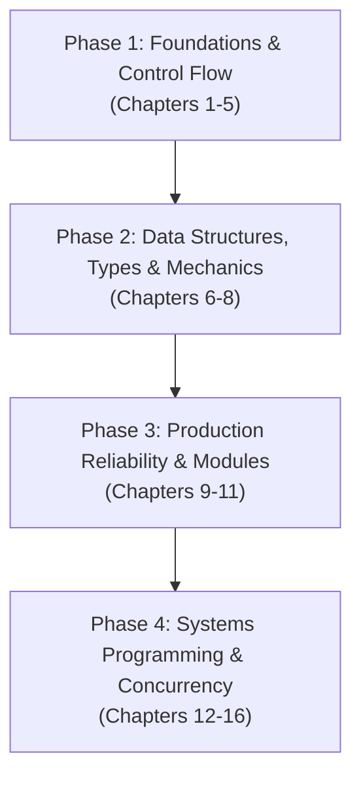

# Book Map: Learning Go (2nd Edition) & The Kubernetes Bridge

This document maps *Learning Go: An Idiomatic Approach to Real-World Go Programming (2nd Edition)* by Jon Bodner (O'Reilly, 16 chapters, 494 pages) and provides the architectural bridge showing how Go language features directly power Kubernetes internals, controllers, and platform tooling.

---

## 🧭 The 4 Phases of Jon Bodner's Book

### Phase 1: Foundations & Control Flow (Chapters 1 to 5)
* **Chapter 1: Setting Up Your Go Environment:** Toolchain (`go build`, `go fmt`, `go vet`), modules, and the Go compatibility promise.
* **Chapter 2: Predeclared Types and Declarations:** Zero values, type conversion, typed versus untyped constants, `var` versus `:=`, and unused variable rules.
* **Chapter 3: Composite Types:** Slices (internals, length, capacity, slicing gotchas), maps (hash table mechanics, comma-ok idiom), and structs.
* **Chapter 4: Blocks, Shadows, and Control Structures:** Shadowing traps with `:=`, `for` loops (four ways), `for-range` semantics, and `switch`.
* **Chapter 5: Functions:** Call-by-value semantics, multiple return values, variadic functions, closures, and `defer` cleanup.

### Phase 2: Data Structures, Types & Memory Mechanics (Chapters 6 to 8)
* **Chapter 6: Pointers:** Pointer mechanics, pointers as mutable parameters, escape analysis (stack vs heap), zero value vs nil, and garbage collection impact.
* **Chapter 7: Types, Methods, and Interfaces:** Value versus pointer receivers, methods for nil instances, composition via embedding (not inheritance), implicit interfaces (duck typing), and type assertions.
* **Chapter 8: Generics:** Type parameters, constraints, generic data structures, and when to avoid generics.

### Phase 3: Production Reliability & Architecture (Chapters 9 to 11)
* **Chapter 9: Errors:** Sentinel errors, errors as values, error wrapping with `%w`, multi-error joins, `errors.Is` and `errors.As`, and panic/recover.
* **Chapter 10: Modules, Packages, and Imports:** Module structure, internal packages, package boundaries, circular dependency prevention, and vendoring.
* **Chapter 11: Go Tooling:** `go install`, `golangci-lint`, `govulncheck`, `go generate`, embed directives, and cross-compilation (`GOOS`/`GOARCH`).

### Phase 4: Systems Programming, Concurrency & Cloud Runtimes (Chapters 12 to 16)
* **Chapter 12: Concurrency in Go:** Goroutines, buffered vs unbuffered channels, `select`, worker cancellation, WaitGroups, sync primitives, and mutexes.
* **Chapter 13: The Standard Library:** `io.Reader`/`io.Writer` streaming, JSON struct tags, JSON streaming decoders, `net/http` clients and servers, and `slog` structured logging.
* **Chapter 14: The Context:** `context.Context`, propagation across process boundaries, cancellation signals, deadlines, and timeouts.
* **Chapter 15: Writing Tests:** Table-driven tests, `t.Parallel()`, benchmarks, coverage, fuzzing, `httptest`, and the race detector (`-race`).
* **Chapter 16: Reflection, Unsafe, and Cgo:** Runtime type inspection, struct tag reflection, memory layout, and systems interop.

---

## ☸️ The Go to Kubernetes Translation Matrix

Kubernetes, `kubectl`, Helm, Cilium, and all Kubernetes Operators are written 100% in Go. 

As you move beyond basic syntax, use this matrix to understand why specific Go patterns exist and how they manifest inside Kubernetes:

| Go Language Concept | Book Chapter | How it manifests in Kubernetes & Cloud-Native Engineering |
| :--- | :--- | :--- |
| **Pointers vs Values** | Chapter 6 | **Manifest Serialization & Patching:** Kubernetes manifests distinguish between an unset field (`nil` pointer) and a zero value (`*val = 0`). For example, `Replicas *int32` in `DeploymentSpec` allows Kubernetes to tell if replicas were omitted or intentionally set to 0. |
| **Struct Tags & JSON** | Chapters 3 & 13 | **Object Schema Definitions:** Every Kubernetes API object is a Go struct tagged with `json:"spec,omitempty"` or `protobuf:"..."`. The API server uses these tags to serialize between YAML manifests and Go memory. |
| **Interfaces & Duck Typing** | Chapter 7 | **`client-go` and Controller Runtime:** Kubernetes uses interfaces everywhere (such as `client.Client`, `runtime.Object`, and `reconcile.Reconciler`). This enables mocking the entire Kubernetes cluster during unit tests with fake clients. |
| **Struct Embedding** | Chapter 7 | **Type Composition:** Custom Resource Definitions (CRDs) embed `metav1.TypeMeta` and `metav1.ObjectMeta` into custom structs to inherit Kubernetes metadata automatically. |
| **Error Wrapping & Inspection** | Chapter 9 | **Reconciliation Flow Control:** In Kubernetes controllers, you inspect errors with `apierrors.IsNotFound(err)` to handle deleted objects gracefully, or return wrapped errors with `%w` to trigger rate-limited controller retries. |
| **Goroutines, Channels & Select** | Chapter 12 | **Informers, WorkQueues & Leader Election:** The Kubernetes control plane uses goroutines and channels to watch API server events, enqueue tasks into rate-limiting WorkQueues, and manage HA leader election. |
| **`context.Context`** | Chapter 14 | **Controller Reconciliation & Graceful Pod Termination:** Every controller reconciliation function begins with `Reconcile(ctx context.Context, req ctrl.Request)`. When a Pod receives `SIGTERM`, the root context cancels, terminating all downstream network calls. |
| **Cross-Compilation (`GOOS=linux`)** | Chapter 11 | **Minimal Container Images:** Go compiles down to a single, statically linked binary. You compile with `CGO_ENABLED=0 GOOS=linux` and copy the single binary into a `scratch` or Distroless Docker image, yielding a tiny 15 MB production container. |

---

## 🗂️ Target Vault Note Architecture for Go & Cloud Engineering

Existing notes in [`6 - Main notes/06 - Go & Software Engineering/Variables/`](file:///home/dor/Documents/Dor-Brain/6%20-%20Main%20notes/06%20-%20Go%20&%20Software%20Engineering/Variables) cover the fundamentals of Chapter 2. 

As you progress through the book, map chapters into atomic notes organized by topic, with explicit Kubernetes bridges:

| Note Title | Book Source | Target Focus & Kubernetes Intersections | Status |
| :--- | :--- | :--- | :--- |
| `Go Toolchain and Running Code.md` | Chapter 1 & Tutorial | `go.mod`, `go.sum`, `go run .` vs `go build`, package `main` entry point | Done |
| `Go Variable Declarations and Zero Values.md` | Chapter 2 | Zero value safety, declaration forms, unused variable rules | Done |
| `Go Predeclared Numeric and Boolean Types.md` | Chapter 2 | Precision, conversions, overflow, untyped literals | Done |
| `Go Strings and Runes.md` | Chapter 2 | UTF-8 encoding, rune slices, byte manipulation | Done |
| `Go Slices and Maps.md` | Chapter 3 | Backing arrays, `append` capacity growth, hash map mechanics, label matching | Next |
| `Go Structs and Data Modeling.md` | Chapter 3 | Struct definitions, anonymous structs, JSON tags, k8s object definitions | Backlog |
| `Go Control Structures and Shadowing Traps.md` | Chapter 4 | `for-range` gotchas, block scope, `err` shadowing in triage scripts | Backlog |
| `Go Functions and Defer Cleanup.md` | Chapter 5 | Call-by-value, closures, `defer` for mutex/socket/file cleanup | Backlog |
| `Go Pointers and Memory Mechanics.md` | Chapter 6 | Stack vs heap, escape analysis, why k8s API objects use pointer fields (`*int32`) | Backlog |
| `Go Methods and Interfaces.md` | Chapter 7 | Pointer vs value receivers, duck typing, `client-go` interfaces and mock clients | Backlog |
| `Go Error Handling in Production.md` | Chapter 9 | Sentinel errors, wrapping with `%w`, `errors.Is`/`errors.As`, k8s `apierrors` | Backlog |
| `Go Concurrency - Goroutines, Channels, and Sync.md` | Chapter 12 | Worker pools, channels, `select`, Mutexes, controller work queues | Backlog |
| `Go Context and Lifecycle Cancellation.md` | Chapter 14 | Deadlines, timeouts, graceful shutdown propagation on `SIGTERM` | Backlog |
| `Go Tooling, Cross-Compilation, and Distroless Containers.md` | Chapter 11 | `GOOS=linux`, static binaries, zero-cgo scratch images | Backlog |
