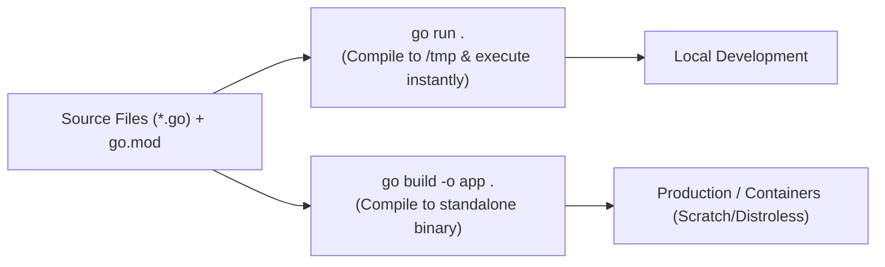

# Go Toolchain and Running Code

## 🧠 The Core Concept

Go is a compiled, statically typed language designed for fast compilation and simple dependency management. 

Unlike languages that require virtual environments or complex build scripts, Go includes a unified toolchain built directly into the `go` command.



### 1. The Execution Model: `go run` vs `go build`
* **`go run .`:** Compiles your code in memory or a temporary directory and executes it immediately. Ideal for fast local development and testing.
* **`go build .`:** Compiles your source files into a single, standalone machine binary. This binary has no dependency on the Go compiler, making it the required choice for production deployments and Docker containers.

### 2. Modules and Dependency Tracking (`go.mod` and `go.sum`)
A **module** is a collection of Go packages stored in a directory tree with a `go.mod` file at its root.
* **`go.mod`:** Defines the module path (identity) and lists the minimum required versions of external packages your project imports.
* **`go.sum`:** Records cryptographic SHA-256 checksums of each downloaded module to ensure supply chain integrity and guarantee reproducible builds across machines.
* **`go mod tidy`:** The dependency garbage collector. It inspects your imports, downloads missing dependencies, removes unused dependencies from `go.mod`, and updates `go.sum`.

### 3. The `package main` Contract
Every standalone Go program requires an entry point:
* The source file must start with `package main`.
* It must contain a `func main()` with no arguments and no return values.
* When the binary runs, execution begins and ends within `main()`.

---

## 💻 Syntax & Minimal Commands

### 1. Project Initialization and Dependency Lifecycle
```bash
# 1. Initialize a new module in the current directory:
go mod init example/hello

# 2. Add external dependencies and clean unused ones:
go mod tidy

# 3. Run the application package in the current directory:
go run .

# 4. Compile into a standalone production binary:
go build -o myapp .
```

### 2. Minimal Example (`main.go`)
```go
package main

import (
	"fmt"

	"rsc.io/quote"
)

func main() {
	// Call external module function:
	fmt.Println(quote.Go())
}
```

---

## ⚠️ Common Pitfalls (The "Gotchas")

* **The `go run main.go` Multi-File Trap:** Running `go run main.go` instructs the compiler to compile *only* that single file. If your `main` package contains helper functions in another file (like `utils.go`), compilation fails with `undefined: helperFunction`. Always run the whole package directory using `go run .`.
* **Using `go run` inside Production Containers:** Running `go run` in production containers requires shipping the complete Go toolchain (compiler, standard library, build tools) into the image. This balloons image sizes to over 800 MB and increases the security attack surface. Use multi-stage Docker builds to compile with `go build` and copy only the binary into a minimal image.
* **Not Committing `go.sum` to Git:** Never add `go.sum` to `.gitignore`. Without `go.sum`, CI pipelines and teammates cannot cryptographically verify that third-party code has not been tampered with.

---

## 🔗 Connections (Mental Mapping)

* **Roadmap Blueprint:** [[Book Map - Learning Go (2nd Edition)]] (Chapter 1 tooling and environment setup)
* **Variable Foundations:** [[Go Variable Declarations and Zero Values]] (declaring variables inside `main()`)
* **Cloud Architecture:** [[Kubernetes Architecture and Control Plane]] (how Go compiles into standalone binaries running on nodes)

---

## ⚡ Active Recall Flashcards

What is the difference between go.mod and go.sum?::`go.mod` defines the module path and dependency requirements; `go.sum` stores cryptographic hashes to guarantee dependency integrity and reproducible builds.

Why should a developer run go run . instead of go run main.go in a multi-file package?::`go run main.go` compiles only that single file and fails to link other files in the package; `go run .` compiles all files in the current package directory.

Why must production containers execute a binary created by go build instead of running go run?::`go run` requires the full Go compiler in the container, creating large and insecure images; `go build` produces a standalone binary that runs in minimal images.

How do you download missing module dependencies and prune unused ones from go.mod?
?
go mod tidy

How do you compile the Go package in the current directory into an executable named server?
?
go build -o server .
