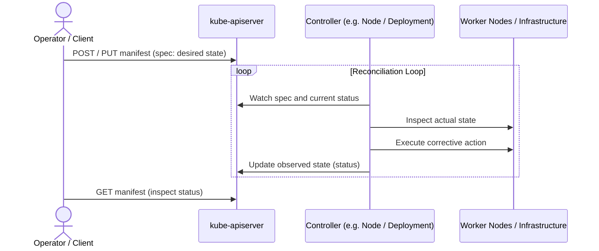

# Kubernetes API and Object Model

## 🧠 The Core Concept

Kubernetes operates as a declarative state machine exposed via an HTTP REST API. You do not issue imperative commands to create processes; instead, you declare the desired state of cluster objects, and autonomous background control loops reconcile the actual world to match that declaration.



### 1. The Anatomy of an Object Manifest
Every object in the Kubernetes API follows a standard four-section structure:

1. **`apiVersion`:** The schema version. Resources in the legacy "core" group omit the group name (such as `v1`), while newer resources require `<group>/<version>` (such as `apps/v1` or `batch/v1`).
2. **`kind`:** The REST resource type being declared (`Pod`, `Node`, `Service`, `Deployment`, `Event`).
3. **`metadata`:** Identity fields shared across all objects (`name`, `namespace`, `labels`, `annotations`, `uid`, `resourceVersion`).
4. **`spec` vs `status` (The Declarative Contract):**
   * **`spec`:** The desired state. Written by the operator or CI/CD client; read by the controller.
   * **`status`:** The observed, actual state. Written by the controller; read by the operator.
   *(Note: Static or informational objects like `Event` do not have `spec` or `status` sections).*

---

## 💻 Syntax & Minimal Inspection Commands

### 1. Interrogating API Schemas Offline
You do not need browser documentation to write or troubleshoot manifests:

```bash
# Display top-level fields and explanation of an object kind:
kubectl explain node

# Drill into specific nested fields:
kubectl explain pod.spec.containers.resources

# View complete nested field hierarchy without descriptions:
kubectl explain pods --recursive
```

### 2. Inspecting Node Health Conditions
Node objects report health through conditions in their `status` block:

```bash
# Query node conditions using json and jq:
kubectl get node <node-name> -o json | jq '.status.conditions[] | {type: .type, status: .status, reason: .reason}'
```

### 3. Triaging Active Incidents with Events
Controllers emit `Event` objects whenever a reconciliation step fails or changes state:

```bash
# List only warning events across the entire cluster:
kubectl get events -A --field-selector type=Warning --sort-by='.lastTimestamp'
```

---

## ⚠️ Common Pitfalls (The "Gotchas")

* **The Condition Polarity Trap:** In `.status.conditions`, "healthy" does not mean all statuses are `True`. While `Ready: "True"` means the node accepts workloads, the resource conditions (`MemoryPressure`, `DiskPressure`, `PIDPressure`) must be `"False"` on healthy nodes. If a pressure condition switches to `"True"`, the kubelet evicts pods or rejects new scheduling requests.
* **The 1-Hour Event TTL:** `Event` objects are ephemeral and expire after **1 hour** by default to protect `etcd` from write bloat. If an incident occurred several hours ago, `kubectl get events` will be empty; root-cause analysis must rely on persistent node logs (`journalctl -u kubelet`) or centralized logging.
* **`kubectl describe` is an Aggregator, Not the Raw Object:** `kubectl get <resource> -o yaml` returns the exact representation stored in `etcd`. `kubectl describe` makes multiple separate API requests behind the scenes to synthesize the target object, its child objects (such as pods assigned to a node), and relevant recent `Event` records into human-readable text.

---

## 🔗 Connections (Mental Mapping)

* **Master Architecture:** [[Kubernetes Architecture and Control Plane]] (the API server and controller manager running the reconciliation loop)
* **Workload Implementation:** [[Kubernetes Workloads - Pods and Deployments]] (how Pod and Deployment specs translate into running containers)
* **Book Blueprint:** [[Book Map - Kubernetes in Action (2nd Edition)]] (how the API model in chapter 4 establishes the schema for all subsequent chapters)

---

## ⚡ Active Recall Flashcards

In a Kubernetes manifest, who writes the spec section and who writes the status section?::The operator or client writes `spec` (desired state); the responsible controller writes `status` (actual observed state).

What does a status of "True" for MemoryPressure or DiskPressure on a node indicate?::The node is resource-starved and unhealthy; healthy nodes must have "False" for all pressure conditions.

Why will kubectl get events fail to show errors from an incident that occurred 3 hours ago?::Event objects have a default 1-hour time-to-live (TTL) in `etcd` before being automatically deleted.

Why does kubectl describe show information that is absent from kubectl get -o yaml?::`kubectl describe` is an aggregator tool that queries multiple API endpoints (child objects, recent events) to produce a synthesized report, whereas `get -o yaml` displays only the raw object.

How can an SRE view the schema and field documentation for an unfamiliar Kubernetes manifest field directly from the terminal?
?
kubectl explain <resource>.<field>

How do you list only warning events across all namespaces sorted by timestamp?
?
kubectl get events -A --field-selector type=Warning --sort-by='.lastTimestamp'
