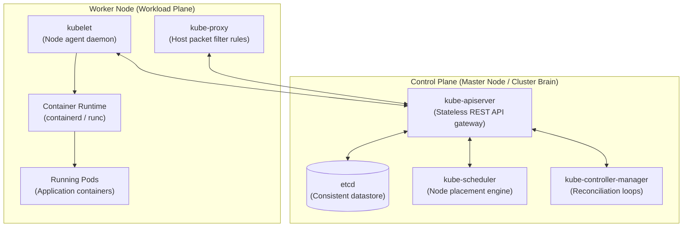

# Kubernetes Architecture and Control Plane

## 🧠 The Core Concept

Kubernetes acts as a **distributed operating system for computer clusters**. It abstracts a fleet of physical or virtual machines into a single unified pool of compute, memory, and storage.

Instead of manually logging into servers to start processes, you declare your desired system state in manifests (YAML/JSON), and Kubernetes continuously reconciles actual state to match desired state.

### 1. Control Plane Components (The Brain)
* **`kube-apiserver`:** The front door. Exposes the REST API. It is completely stateless and is the **only** component in the entire cluster that communicates directly with `etcd`.
* **`etcd`:** A distributed, consistent key-value store (using the Raft consensus algorithm). Holds the complete cluster state. If an object is not in `etcd`, it does not exist.
* **`kube-scheduler`:** Watches for newly created Pods that have no assigned node. It evaluates resource availability, constraints, and affinity to assign the Pod to the best worker node.
* **`kube-controller-manager`:** Runs core background control loops. For example, the Node Controller detects dead nodes, while the Deployment/ReplicaSet Controller ensures the correct number of Pod replicas remain running.

### 2. Worker Node Components (The Workload Plane)
* **`kubelet`:** An agent running as a systemd service on every node. It watches the API server for Pods assigned to its node, instructs the local container runtime to run them, and reports container health back to the control plane.
* **Container Runtime (CRI):** The software responsible for pulling images and running container processes (such as `containerd` or CRI-O, driving `runc`).
* **`kube-proxy`:** A network helper running on each node. It reflects Kubernetes Service definitions into local Linux kernel packet filters (`iptables` or IPVS) to direct traffic to backend Pods.

---

### ⚖️ Architectural Decision: Plain Servers vs. Kubernetes

* **Stay on Plain Servers / Docker Compose when:**
  * You run a small monolithic application with a small engineering team.
  * You cannot afford the maintenance tax: cluster upgrades, CNI networking debugging, certificate rotation, and control plane memory overhead.
  * You run primary stateful databases (PostgreSQL, MySQL). Dedicated VMs or managed cloud database services are simpler and avoid storage attachment failover risks.
* **Choose Kubernetes when:**
  * You manage dozens of microservices with frequent, independent deployments.
  * You need automated self-healing (rescheduling crashed containers across surviving machines).
  * You need elastic autoscaling driven by incoming traffic metrics.
  * You require a standardized deployment API that runs identically across AWS, GCP, and bare-metal servers.

---

## ⚠️ Common Pitfalls (The "Gotchas")

* **`etcd` is the single point of failure:** If `etcd` loses quorum or runs out of disk space, the API server enters read-only failure mode. Existing containers will continue running on worker nodes, but no new Pods can be scheduled, updated, or healed.
* **Kubelet talks CRI, not Docker directly:** Modern Kubernetes uses the Container Runtime Interface (CRI) over gRPC. Do not expect `docker ps` to show Kubernetes containers unless you explicitly installed the obsolete Docker wrapper. Use `crictl ps` to inspect runtime containers on the node directly.
* **Controller Manager vs Scheduler separation:** The Scheduler only *picks* the node. It does not create Pods or start containers. The Controller Manager creates missing Pods, and the Kubelet actually starts them.

---

## 🔗 Connections (Mental Mapping)

* **Kernel Foundation:** [[Linux Namespaces]] (the underlying isolation primitives used on nodes)
* **Runtime Layer:** [[Container Runtimes (containerd and runc)]] (the CRI implementation managed by Kubelet)
* **Workload Layer:** [[Kubernetes Workloads - Pods and Deployments]] (the application objects scheduled by this architecture)
* **Lightweight Distribution (k3s):** [[k3s Architecture and Operations]] (single-binary architecture and operations)

---

## ⚡ Active Recall Flashcards

What is the only Kubernetes control plane component that reads and writes directly to etcd?::The Kubernetes API Server (`kube-apiserver`)

Which control plane component detects when a worker node stops reporting heartbeats?::The Node Controller (running inside `kube-controller-manager`)

A network split isolates a worker node from the control plane. Do containers on that node stop running immediately?::No. Containers continue running uninterrupted; the control plane simply loses contact and schedules replacements elsewhere after a timeout.

An SRE needs to inspect low-level container processes directly on a Kubernetes node without kubectl. What tool is used?::`crictl` (the CLI for the Container Runtime Interface)
