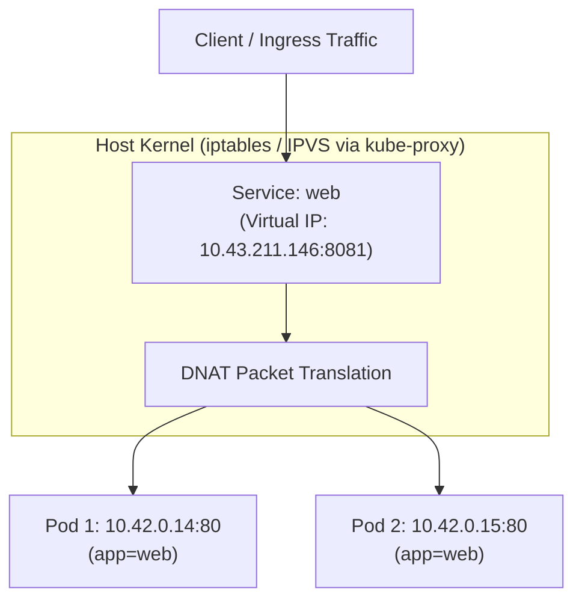

# Kubernetes Services and Traffic Routing

## 🧠 The Core Concept

In Kubernetes, Pods are ephemeral. As Pods are created, killed, or rescheduled, their internal IP addresses constantly change.

A **Service (`svc`)** solves this problem by providing a permanent, stable virtual IP address (ClusterIP) and internal DNS entry that fronts a group of Pods. Clients connect to the Service, and Kubernetes transparently routes and load balances the traffic across healthy backend Pods.



### 1. Label Selectors and Endpoints
* A Service identifies its target Pods using **label selectors** (such as `app=web`).
* The control plane automatically maintains an **`Endpoints`** (or `EndpointSlice`) object behind the scenes, tracking the active IP addresses and ports of all healthy Pods that match the selector.

### 2. Under the Hood: The Service Mechanism
A Service is **not** a traditional process or reverse proxy daemon listening on a port.
* The Service ClusterIP is a purely **virtual IP address**.
* **`kube-proxy`** runs on every node, watching the API server for changes to Services and Endpoints.
* When a Service is created, `kube-proxy` programs the host's Linux kernel packet filtering rules (**`iptables`** or **IPVS**).
* When a packet arrives destined for the Service virtual IP, the Linux kernel intercepts it and rewrites the destination IP (Destination NAT / DNAT) directly to one of the healthy Pod IPs before routing the packet.

---

## 💻 Syntax & Inspection Commands

### 1. Imperative Service Creation
```bash
# Expose a deployment as an internal cluster service (ClusterIP):
kubectl expose deployment web --type=ClusterIP --port 80 --target-port 80

# Expose a deployment externally via a LoadBalancer:
kubectl expose deployment web --type=LoadBalancer --name=web --port 8081 --target-port 80

# List active services in the current namespace:
kubectl get svc

# Inspect the backend Pod IPs currently attached to the service:
kubectl get endpoints web
```

### 2. Declarative Combined Manifest (`app.yaml`)
In Kubernetes, multiple resources can be defined in a single file by separating them with `---`:

```yaml
apiVersion: apps/v1
kind: Deployment
metadata:
  name: web-deployment
  labels:
    tier: frontend              # Top-level label (identifies the Deployment object itself)
spec:
  replicas: 3
  selector:
    matchLabels:
      app: web                  # Must match template labels below
  template:
    metadata:
      labels:
        app: web                # The sticky label pinned to every created Pod
    spec:
      containers:
      - name: nginx
        image: nginx:1.25
        ports:
        - containerPort: 80      # Documentation of port listening inside the container
---
apiVersion: v1
kind: Service
metadata:
  name: web-service              # DNS name inside cluster: web-service.<namespace>.svc.cluster.local
spec:
  type: ClusterIP                # Virtual IP for internal cluster communication
  selector:
    app: web                    # The magnet: selects Pods with template label app=web
  ports:
  - protocol: TCP
    port: 8080                   # Port exposed by the Service ClusterIP
    targetPort: 80               # Port forwarded to on the destination Pod
```

---

## ⚠️ Common Pitfalls (The "Gotchas")

* **The Factory vs. Worker Label Trap (Empty Endpoints):** A Service routes traffic to Pods, never to Deployments. A Service's `spec.selector` matches strictly against the Pod template labels (`spec.template.metadata.labels`), completely ignoring the Deployment's top-level `metadata.labels`. If `spec.selector` points to a top-level Deployment label that is missing from the Pod template, `kubectl get endpoints <service>` will show `<none>`, and connections will immediately fail with `Connection refused` (TCP RST).
* **ClusterIP does not respond to ping (ICMP):** Because a Service ClusterIP exists only as kernel NAT rules for TCP/UDP traffic, sending an ICMP `ping` to a Service IP will fail or timeout, even when HTTP/TCP requests succeed completely.
* **Empty Endpoints (Label Mismatch):** If a Service is created but requests hang or return connection refused, check `kubectl get endpoints <service>`. If it shows `<none>`, the Service's `selector` does not match the `labels` in the Pod's template.
* **LoadBalancer type without cloud infrastructure:** A standard upstream Kubernetes Service configured with `type: LoadBalancer` expects a cloud provider (AWS, GCP) or bare-metal controller (like MetalLB or k3s Klipper) to allocate an external IP. Without one, the external IP stays stuck in `<pending>`. See [[k3s Architecture and Operations]] for how k3s handles this locally.

---

## 🔗 Connections (Mental Mapping)

* **Workload Layer:** [[Kubernetes Workloads - Pods and Deployments]] (the Pods grouped behind the Service)
* **Distro Implementation (k3s):** [[k3s Architecture and Operations]] (Klipper LoadBalancer and Traefik mechanics)
* **Node Networking:** [[Kubernetes Architecture and Control Plane]] (the role of `kube-proxy` on worker nodes)
* **Network Foundation:** [[Container Networking and CNM]] (virtual interfaces and packet translation fundamentals)

---

## ⚡ Active Recall Flashcards

Why must application clients connect to a Service instead of a Pod IP directly?::Pod IPs are ephemeral and change whenever Pods restart or reschedule; a Service provides a stable virtual IP and DNS name.

Does a Kubernetes Service run as a dedicated process listening on a port?::No. It is a virtual IP implemented via host kernel packet-filtering rules (`iptables` or IPVS) configured by `kube-proxy`.

Which label block in a Deployment must a Service selector match?::The Pod template labels (`spec.template.metadata.labels`), not the top-level Deployment `metadata.labels`.

A Service times out or drops traffic. What command checks if any healthy Pods are attached to it?::`kubectl get endpoints <service-name>` (or `kubectl describe svc <service-name>`)

Why does pinging a Kubernetes ClusterIP fail even when application traffic works normally?::ClusterIP is an iptables/IPVS translation rule for TCP/UDP packets, not a real host interface, so it does not respond to ICMP ping.

How do you imperatively expose a deployment named web on port 8081 forwarding to container port 80 using a LoadBalancer?
?
kubectl expose deployment web --type=LoadBalancer --port 8081 --target-port 80

