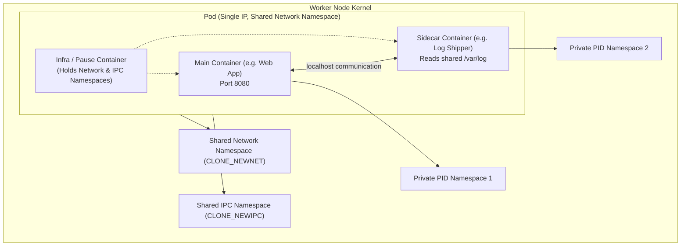

# Kubernetes Workloads - Pods and Deployments

## 🧠 The Core Concept

Kubernetes does not deploy individual containers directly to worker nodes. The atomic scheduling unit in Kubernetes is the **Pod**.

A **Pod** is a group of one or more closely related containers that share storage and network resources, and always run co-located on the same physical or virtual worker node.



### 1. Pod Kernel Mechanics (What is a Pod under the hood?)
* **Shared Network Namespace (`CLONE_NEWNET`):** All containers within a Pod share a single network interface and IP address. They communicate with each other over `localhost` on different ports, exactly like processes on the same Linux host.
* **Shared IPC Namespace (`CLONE_NEWIPC`):** Containers in the same Pod can communicate using System V IPC or POSIX message queues.
* **Isolated Filesystems & Process Trees:** Containers maintain their own isolated Mount namespaces (independent file trees) and, by default, separate PID namespaces (`CLONE_NEWPID`). A container process cannot see another container's processes unless `shareProcessNamespace: true` is configured.

### 2. The Deployment Object (Managing Desired State)
Pods are ephemeral. If an individual Pod dies, Kubernetes does not automatically revive that specific instance unless it is managed by a controller.

A **Deployment** is a declarative controller that manages Pod replicas. You declare the desired state (for example, "always run 3 copies of application image X"), and the Deployment controller constantly ensures that actual state matches desired state.

---

## 💻 Syntax & Minimal Commands

### 1. Imperative Management (Ad-Hoc / Fast Triage)
```bash
# Create a deployment using an image:
kubectl create deployment web --image=dorbit01/web-app:1.0 --port=80

# Scale the deployment to 3 replica pods:
kubectl scale deployment web --replicas=3

# Update container image on an existing deployment:
kubectl set image deployment/web web-app=dorbit01/web-app:1.0

# Monitor rollout status until complete:
kubectl rollout status deployment/web

# Inspect deployment status:
kubectl get deployments

# Inspect pods, displaying assigned worker nodes and pod IPs:
kubectl get pods -o wide
```

### 2. Declarative Manifest (`deployment.yaml`)
In production, deployments are declared in version-controlled manifests:

```yaml
apiVersion: apps/v1
kind: Deployment
metadata:
  name: web
spec:
  replicas: 3
  selector:
    matchLabels:
      app: web
  template:
    metadata:
      labels:
        app: web
    spec:
      containers:
      - name: web-app
        image: dorbit01/web-app:1.0
        ports:
        - containerPort: 80
```

Apply or update declaratively:
```bash
kubectl apply -f deployment.yaml
```

---

## ⚠️ Common Pitfalls (The "Gotchas")

* **Port conflicts inside a Pod:** Because containers in the same Pod share the network namespace, two containers in the same Pod cannot bind to the same port (e.g. both listening on `8080`). One will crash with an `address already in use` error.
* **PID isolation is the default:** By default, containers in the same Pod cannot send signals (like `SIGTERM` or `SIGHUP`) to each other or inspect each other via `/proc`, because their PID namespaces remain isolated.
* **Ephemeral Pod IPs:** Pods are mortal. Never hardcode a Pod IP address into another service or client configuration. When a Pod restarts or reschedules, it receives a completely different IP.
* **Default Hostname is the Pod Name:** Inside a container, the system hostname (e.g. `os.Hostname()` in Go) defaults to the Kubernetes Pod name.

---

## 🔗 Connections (Mental Mapping)

* **Cluster Infrastructure:** [[Kubernetes Architecture and Control Plane]] (the master controllers that schedule Pods)
* **Distro Implementation (k3s):** [[k3s Architecture and Operations]] (lightweight single-binary k3s operations)
* **Traffic Routing:** [[Kubernetes Services and Traffic Routing]] (the stable virtual IP layer required in front of dynamic Pods)
* **Kernel Primitives:** [[Linux Namespaces]] (specifically `CLONE_NEWNET` and `CLONE_NEWPID`)

---

## ⚡ Active Recall Flashcards

Which Linux kernel namespace is shared by all containers inside the same Kubernetes Pod?::The Network Namespace (`CLONE_NEWNET`), enabling them to share one IP and talk over `localhost`

Do containers inside the same Pod share their PID namespace by default?::No. They keep isolated PID namespaces unless `shareProcessNamespace: true` is explicitly enabled in the Pod spec.

What failure occurs if two containers inside the same Pod both bind to port 8080?::The second container fails to start with an `address already in use` port conflict error.

What does the system hostname (`os.Hostname()` in Go) default to inside a container running in Kubernetes?::The Pod name

How does an SRE check which worker node each Pod is scheduled onto from the CLI?
?
kubectl get pods -o wide

How do you imperatively scale a deployment named web to 5 replicas?
?
kubectl scale deployment web --replicas=5

How do you imperatively update a deployment named web with container web-app to image app:2.0?
?
kubectl set image deployment/web web-app=app:2.0
