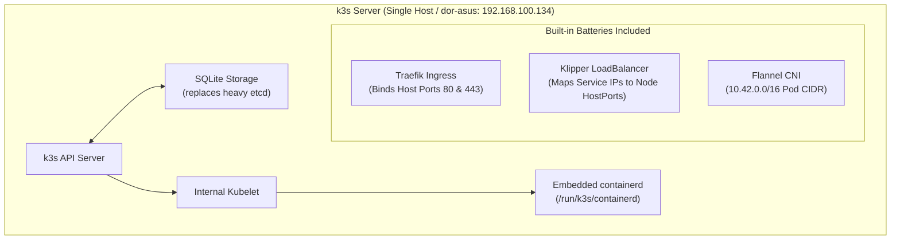

# k3s Architecture and Operations

## 🧠 The Core Concept

**k3s** is a lightweight, fully compliant Kubernetes distribution created by Rancher for edge computing, IoT, and homelabs.

Standard upstream Kubernetes consists of multiple separate daemons (API server, controller-manager, scheduler, kubelet, kube-proxy, etcd). k3s packages all of these components into a **single binary** (under 100 MB).



### 1. Key Architectural Differences from Standard Kubernetes
* **Datastore**: Single-node k3s replaces etcd with an embedded **SQLite** database, saving hundreds of megabytes of RAM.
* **Batteries Included**: Includes built-in networking (Flannel), local storage provisioner (`local-path-provisioner`), an ingress controller (Traefik), and a service load balancer (Klipper).
* **Embedded Container Runtime**: Runs containerd directly inside the k3s process tree, listening on `/run/k3s/containerd/containerd.sock`.

### 2. How Klipper LoadBalancer Works
In public clouds (AWS, GCP), creating a Service with `type: LoadBalancer` asks the cloud API to provision an external cloud load balancer. 

Bare-metal servers and homelabs have no cloud API. k3s solves this with **Klipper**:
1. When you create a Service with `type: LoadBalancer`, k3s deploys a small helper pod (`svclb-<service>`).
2. That helper pod uses host networking to bind the requested port directly on the worker node's physical IP (`192.168.100.134`).
3. External traffic hitting `192.168.100.134:<port>` is routed directly into the cluster Service.

---
## 💻 Minimal Setup & Node Triage (K3s Local Lab)

In a home lab on an older laptop, running full production multi-node Kubernetes consumes too much RAM. **k3s** is a lightweight, certified distribution that packages the control plane, worker components, and SQLite/embedded etcd into a single binary.

### 1. Installation and Non-Root Access
```bash
# Install k3s as a systemd service:
curl -sfL https://get.k3s.io | sh -

# Configure kubectl permissions for your regular user:
mkdir -p ~/.kube
sudo cp /etc/rancher/k3s/k3s.yaml ~/.kube/config
sudo chown $USER:$USER ~/.kube/config
chmod 600 ~/.kube/config

# Add config path and shell completion to your shell:
echo 'export KUBECONFIG=~/.kube/config' >> ~/.bashrc
echo 'source <(kubectl completion bash)' >> ~/.bashrc
echo 'alias k=kubectl' >> ~/.bashrc
echo 'complete -o default -F __start_kubectl k' >> ~/.bashrc
source ~/.bashrc
```

### 2. Basic Cluster and Host Inspection
```bash
# Check node readiness:
kubectl get nodes

# Triage node kubelet health via systemd on the host:
systemctl status kubelet

# Tail node logs to debug container runtime or API issues:
journalctl -u kubelet -f
```

---

## 💻 Syntax & Minimal Commands

### 1. Service Supervision (Systemd)
k3s runs as a standard Linux systemd service on the node:

```bash
# Check k3s status:
sudo systemctl status k3s

# Tail cluster logs:
sudo journalctl -u k3s -f
```

### 2. Kubeconfig Access
The administrative cluster credentials live in `/etc/rancher/k3s/k3s.yaml`:

```bash
# Point local kubectl directly to the k3s cluster config:
export KUBECONFIG=/etc/rancher/k3s/k3s.yaml
kubectl get nodes
```

### 3. Interacting with Embedded Containerd
Because k3s uses its own embedded containerd instance, host `docker` commands do not see images inside k3s unless imported:

```bash
# List images stored inside k3s containerd:
sudo k3s ctr images list

# Import an image directly from workstation over SSH without a registry:
docker save dorbit01/web-app:1.0 | ssh dor-asus "sudo k3s ctr images import -"
```

---

## ⚠️ Common Pitfalls (The "Gotchas")

* **Port 80 Collision with Built-in Traefik:** Traefik comes pre-installed in k3s and binds host ports 80 and 443 via Klipper. If you create a `LoadBalancer` service requesting port 80 on a single-node cluster, it will conflict with Traefik. Choose an alternate port (such as 8081 or 8080) for application LoadBalancer services, or use Traefik Ingress routes instead.
* **Docker vs k3s Container Storage:** Building an image with `docker build` on the host does not automatically place that image inside k3s. You must either push the image to a container registry (Docker Hub) so k3s can pull it, or import it using `k3s ctr images import`.
* **Kubeconfig Root Permissions:** By default, `/etc/rancher/k3s/k3s.yaml` has `0600` permissions and belongs to `root`. Non-root users need `sudo` or a copied kubeconfig with user ownership to run `kubectl`.

---

## 🔗 Connections (Mental Mapping)

* **General Workloads:** [[Kubernetes Workloads - Pods and Deployments]] (standard Pod and Deployment mechanics)
* **General Routing:** [[Kubernetes Services and Traffic Routing]] (Service types and virtual IP mechanics)
* **Control Plane Mechanics:** [[Kubernetes Architecture and Control Plane]] (standard upstream Kubernetes components)
* **Container Runtime:** [[Container Runtimes (containerd and runc)]] (how containerd runs behind the scenes)

---

## ⚡ Active Recall Flashcards

How does single-node k3s minimize memory usage compared to standard Kubernetes?::It replaces etcd with an embedded SQLite database and packages all components into a single binary.

How does k3s provide LoadBalancer services on bare-metal without a cloud provider?::It uses Klipper LoadBalancer, running helper pods that bind host ports directly on the node physical IP.

Why does exposing a LoadBalancer service on port 80 fail or conflict on a default k3s node?::Because the built-in Traefik ingress controller already binds host ports 80 and 443 by default.

Which CLI command imports a saved docker image archive directly into k3s containerd?
?
k3s ctr images import -
